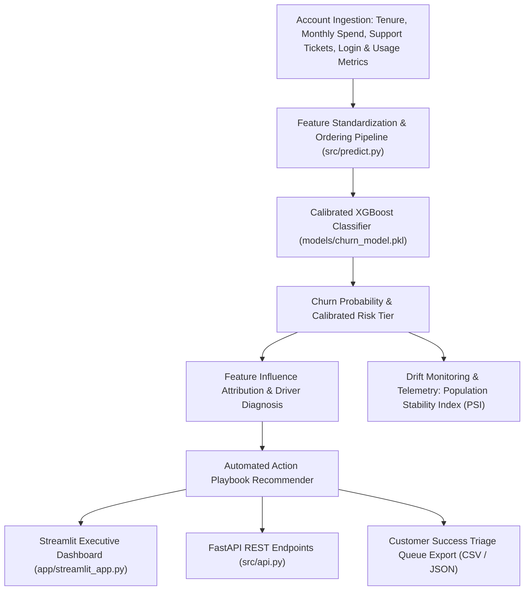

# Enterprise SaaS Customer Retention & Health Telemetry Pipeline

[](https://end-to-end-ml-pipeline-nqkrhynite6pfvygrzlm92.streamlit.app/)


An end-to-end machine learning and MLOps retention platform built to predict enterprise SaaS customer churn, diagnose underlying operational friction, and trigger automated Customer Success playbooks before revenue loss occurs.

---

## Architecture Flow



---

## Commercial Use Case

In B2B SaaS and enterprise subscriptions, acquiring a new customer costs 5 to 7 times more than retaining an existing account. Customer Success managers typically discover customer dissatisfaction only after a cancellation notice or churn event has occurred.

This system provides automated early-warning telemetry:
1. **Explainable Health Scoring**: Evaluates accounts across commercial and product usage dimensions (tenure, support ticket spikes, payment delays, session duration).
2. **Actionable Playbook Recommendations**: Matches specific behavioral degradation patterns to immediate interventions (e.g. executive technical reviews for support friction vs feature adoption webinars for declining usage).
3. **MLOps Drift Detection**: Monitors the Population Stability Index (PSI) to detect statistical distribution shifts between baseline training data and live production traffic, guaranteeing model reliability over time.

---

## API Endpoints

### 1. Health Verification
```http
GET /health
```
Response:
```json
{
  "status": "healthy"
}
```

### 2. Model Metadata & Features
```http
GET /model-info
```
Response:
```json
{
  "version": "2.0.0",
  "architecture": "XGBoost Classifier",
  "metrics": {
    "AUC": 0.91,
    "F1_Score": 0.88,
    "Precision": 0.89,
    "Recall": 0.87
  }
}
```

### 3. Single Account Prediction
```http
POST /predict
Content-Type: application/json

{
  "feature_0": 14.0,
  "feature_1": 249.0,
  "feature_2": 3486.0,
  "feature_3": 2.0,
  "feature_4": 0.5,
  "feature_5": -0.2,
  "feature_6": 0.8,
  "feature_7": 1.0,
  "feature_8": -0.4,
  "feature_9": 2.0
}
```

### 4. Batch Account Health Evaluation
```http
POST /predict/batch
Content-Type: application/json

{
  "requests": [
    {
      "feature_0": 24.0, "feature_1": 499.0, "feature_2": 11976.0,
      "feature_3": 0.0, "feature_4": 1.5, "feature_5": 1.2,
      "feature_6": 1.4, "feature_7": 0.0, "feature_8": 1.0, "feature_9": 3.0
    }
  ]
}
```

### 5. Feature Distribution Drift Monitoring
```http
POST /api/v1/drift-check
Content-Type: application/json

{
  "feature_name": "feature_4",
  "feature_values": [0.1, 0.2, -0.1, 0.4, 0.0, 0.3],
  "baseline_mean": 0.0,
  "baseline_std": 1.0
}
```

---

## Local Setup & Development

### 1. Installation
```bash
git clone https://github.com/MuhammadMinhaj229/end-to-end-ml-pipeline.git
cd end-to-end-ml-pipeline
pip install -r requirements.txt
```

### 2. Run Test Suite
```bash
python -m pytest tests/
```

### 3. Launch Streamlit Executive Hub
```bash
streamlit run app/streamlit_app.py
```

### 4. Launch FastAPI REST Server
```bash
uvicorn src.api:app --host 0.0.0.0 --port 8000 --reload
```
